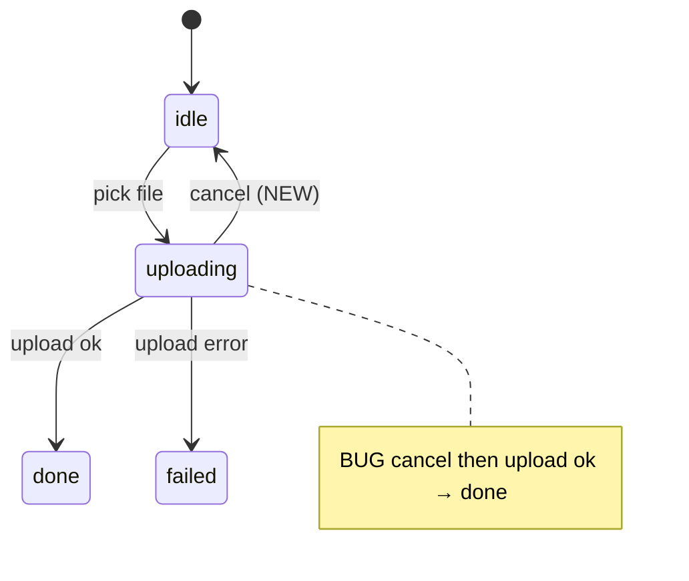

# The implicit state machine

Most bugs in a change come from state it never names. Rebuild the state
machine the diff touches, then check it. Every finding carries the event
sequence that triggers it, so the test skill can replay it.

## Build it

1. **Find the state:**
   - status strings and enums;
   - booleans that together make a mode (`isLoading`, `error`, `data`);
   - nullable fields;
   - DB status columns, job and queue states;
   - UI modes and timers.
2. **Find the events:** handlers, callbacks, effects, webhooks, retries,
   timeouts, unmount, refresh, the back button.
3. **Map the transitions:** which event writes which state, under what
   guard. Note every write to state that the handler doesn't own.
4. **Draw it:** one Mermaid `stateDiagram-v2` per machine, with the diff's
   changes marked `(NEW)` and bugs as notes.
5. **Walk it:** every state × event pair the diff touches, against the
   patterns below.

Keep to the machines the diff adds or changes. A machine the diff only
reads is out of scope unless the diff breaks it.

## Bug patterns

| Pattern | Example |
| --- | --- |
| An impossible combination can be stored | `isLoading && error` both true; the UI shows a spinner over an error |
| A state with no exit | `processing` has no timeout or failure path; stuck forever |
| A missing transition | Cancel during `uploading` isn't handled; the upload finishes anyway |
| No guard on the source state | Double submit; a webhook delivered twice moves `paid → paid` and emails twice |
| Out-of-order async | A slow response for an old query overwrites the newer one |
| Reset of state another action owns | `selectThread(null)` also clears `composeMode`, so "New email" does nothing |
| Not cleaned up on failure or unmount | A timer or subscription keeps firing after the view closes |
| An unhandled stored value | A DB status this change adds isn't in a `switch` elsewhere |
| Rehydration | State restored from storage or the URL lands in a state no event can reach |

## What the report shows

Each finding gives:

- the pattern;
- the event sequence (`pick file → cancel → upload ok`);
- file:line;
- a suggested guard.

Then:

- **`--fix`:** fix it, and add a test that replays the sequence.
- **`--feedback`:** one comment with the sequence and a small code block.
